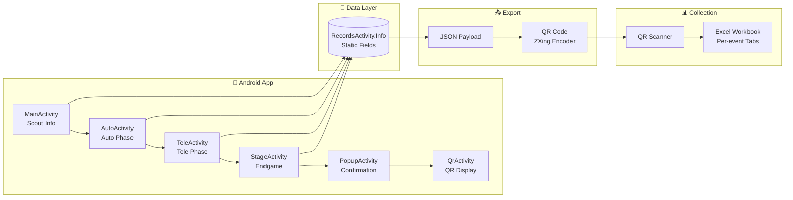

# FRC 2024 Crescendo Match Scouting App

<div align="center">

[](https://developer.android.com/)
[](https://docs.oracle.com/en/java/javase/17/)
[](https://developer.android.com/about/versions/lollipop)
[](https://firstfrc.blob.core.windows.net/frc2024/Manual/2024GameManual.pdf)

**Android app that encodes robot performance data into QR codes for offline scouting at FRC competitions.**

[Features](#features) · [Screenshots](#screenshots) · [Architecture](#architecture) · [Usage Stats](#usage-stats) · [Build](#build-instructions)

</div>

---

## Background

As a sophomore on [FRC Team 1730 (Team Driven)](https://www.thebluealliance.com/team/1730/2023), I took over as the solo developer of the scouting app. My freshman year I'd served as a scout lead under seniors Heath Crump and Caden Findlay — [Newton Division winners](https://www.thebluealliance.com/event/2022new) who reached [Einstein](https://www.thebluealliance.com/event/2022cmptx). I learned the ropes from them, and sophomore year I built the Android match app myself: Java, XML layouts, QR encoding, the whole pipeline into Excel. I learned a lot, struggled a lot, and got it done.

Junior year (this repo), I kept the match app going for Crescendo and spotted pit scouting as a bottleneck, so I built a [second app](https://github.com/aamir-frc-scouting/frc-pit-scouting-app-2024) for it. Senior year I took it further: cross-platform Flutter apps that still export QR codes, scanned by a Python/customtkinter intake app into SQLite so strategy questions become SQL queries. — [Aamir Abatiyow](https://github.com/AamirAbatiyow)

## Screenshots

<div align="center">
<table>
  <tr>
    <td align="center"><br/>Pre-Match</td>
    <td align="center"><br/>Autonomous</td>
    <td align="center"><br/>Teleoperated</td>
  </tr>
  <tr>
    <td align="center"><br/>Endgame</td>
    <td align="center"><br/>Confirmation</td>
    <td align="center"><br/>QR Output</td>
  </tr>
</table>
</div>

Rendered at 10" portrait tablet size, the devices the team scouted on.

## Features

- **Multi-phase match tracking** — Dedicated screens for Autonomous, Teleoperated, and Endgame phases
- **Game piece scoring** — Track Notes scored in Amp and Speaker during both Auto and Tele
- **Endgame tracking** — Record Stage status (Park/Onstage/Spotlit), Harmony, and Trap
- **Field position selection** — Visual field overlay for selecting robot starting position and driver station
- **Validation flow** — Confirmation screen before QR generation prevents accidental data loss
- **QR code export** — All 19 data fields encoded as JSON, displayed as scannable QR code
- **Match auto-increment** — Match number automatically increments after each submission
- **Free-text comments** — Per-phase comment fields for qualitative observations
- **Offline-first** — No network required during competition

## Usage Stats

| Event | Matches | Data Points |
|:------|--------:|------------:|
| [Heartland Regional](https://www.thebluealliance.com/event/2024ksla) | 88 | 10,032 |
| [Greater Kansas City Regional](https://www.thebluealliance.com/event/2024mokc) | 99 | 11,286 |
| [Green Country Regional](https://www.thebluealliance.com/event/2024oktu) | 87 | 9,918 |
| [Milstein Division](https://www.thebluealliance.com/event/2024mil) | 140 | 15,960 |
| [MO-KAN State Championship](https://www.thebluealliance.com/event/2024mksc) | 72 | 8,208 |
| **Total** | **486** | **55,404** |

Formula: matches × 6 robots × 19 fields = data points

**2024 season results supported by this scouting data:**
- Green Country Regional winners
- Heartland Regional finalists + Impact Award
- Greater Kansas City Regional #1 seed
- Milstein Division finalists
- MO-KAN State Championship winners

See [Team 1730's 2024 season](https://www.thebluealliance.com/team/1730/2024) on The Blue Alliance.

## Architecture

### Data Flow



### QR Payload Schema (19 Fields)

| Field | Type | Description |
|-------|------|-------------|
| `Name` | string | Scout's name |
| `Match` | string | Match number |
| `Team` | string | Robot's team number |
| `Preload` | 0/1 | Robot started with a Note preloaded |
| `Station` | 1–3 | Driver station (Red 1, 2, or 3) |
| `Pos` | 1–4 | Starting field position |
| `Leave` | 0/1 | Robot left starting zone in Auto |
| `AutoNote` | int | Total Notes picked up in Auto |
| `AutoAmp` | int | Notes scored in Amp during Auto |
| `AutoSpeaker` | int | Notes scored in Speaker during Auto |
| `AutoComment` | string | Auto phase observations |
| `TeleNote` | int | Total Notes picked up in Tele |
| `TeleAmp` | int | Notes scored in Amp during Tele |
| `TeleSpeaker` | int | Notes scored in Speaker during Tele |
| `TeleComment` | string | Tele phase observations |
| `Stage` | 0–3 | Endgame: 0=None, 1=Park, 2=Onstage, 3=Spotlit |
| `Harmony` | 0/1 | Achieved Harmony bonus |
| `Trap` | 0/1 | Scored in Trap |
| `StageComment` | string | Endgame observations |

### Project Structure

```
app/
├── src/main/java/com/example/scouting_app_2024/
│   ├── MainActivity.java      # Scout info, driver station, field position
│   ├── AutoActivity.java      # Autonomous phase scoring
│   ├── TeleActivity.java      # Teleoperated phase scoring
│   ├── StageActivity.java     # Endgame (Stage, Harmony, Trap)
│   ├── PopupActivity.java     # Confirmation before finalizing
│   ├── QrActivity.java        # QR code generation and display
│   └── RecordsActivity.java   # Static data store + JSON serialization
└── src/main/res/layout/       # XML layouts for each activity
QRGenerator/                   # ZXing-based QR encoding module
```

## Build Instructions

### Requirements

- **Android Studio** Hedgehog (2023.1.1) or later
- **JDK 17+** (JDK 21 supported)
- **Android SDK** with API 34 (compile) and API 21+ (minimum)

### Steps

```bash
# Clone the repository
git clone https://github.com/aamir-frc-scouting/frc-scouting-app-2024.git
cd frc-scouting-app-2024

# Set Android SDK path (if not set via ANDROID_HOME)
echo "sdk.dir=/path/to/android/sdk" > local.properties

# Build debug APK
./gradlew assembleDebug

# Output: app/build/outputs/apk/debug/app-debug.apk
```

### Install on Device

```bash
# Connect Android device with USB debugging enabled
adb install -r app/build/outputs/apk/debug/app-debug.apk
```

## What Came Next

This Java/Android + QR-to-Excel pipeline worked reliably for the 2024 season, but had limitations:

**Pain points identified:**
- Manual QR scanning into Excel was time-consuming between matches
- No real-time data aggregation
- Platform-specific (Android only)
- No offline data persistence on device

**2025 Rewrite (Flutter + SQL):**
- Cross-platform Flutter apps (one codebase for Android + iOS)
- Same QR transfer workflow, but scanned into a Python/customtkinter desktop intake app that validates each record
- SQLite instead of Excel tabs, so strategy questions become SQL queries
- Offline-first architecture with persistent storage on device

| Season | App | Stack | Scale |
|--------|-----|-------|-------|
| 2023 | [Match Scouting](https://github.com/aamir-frc-scouting/frc-scouting-app-2023) | Java/Android | 3 events, 58K data points |
| 2024 | **Match Scouting** | Java/Android | 5 events, 55K data points |
| 2024 | [Pit Scouting](https://github.com/aamir-frc-scouting/frc-pit-scouting-app-2024) | Java/Android | 230 teams scouted |
| 2025 | [Match Scouting](https://github.com/aamir-frc-scouting/frc-scouting-app-2025) | Dart/Flutter | Cross-platform rewrite |
| 2025 | [Pit Scouting](https://github.com/aamir-frc-scouting/frc_pit_scouting_app_2025) | Dart/Flutter | Cross-platform rewrite |

## Tech Stack

| Component | Technology |
|-----------|------------|
| Language | Java 17 |
| Platform | Android (API 21+) |
| UI | ConstraintLayout, Material Components |
| QR Generation | ZXing (via local QRGenerator module) |
| Build System | Gradle 8.6, AGP 8.3.2 |
| Screenshot Tests | [Paparazzi](https://github.com/cashapp/paparazzi) 1.3.4 |
| Data Format | JSON encoded in QR |
| Data Import | Excel VBA macros (external) |

## License

This repository does not currently have a license. Please contact the author before using this code in your own projects.

---

<div align="center">

**Part of the [Team 1730 scouting system](https://github.com/aamir-frc-scouting)**

[2023 Match](https://github.com/aamir-frc-scouting/frc-scouting-app-2023) · **2024 Match** · [2024 Pit](https://github.com/aamir-frc-scouting/frc-pit-scouting-app-2024) · [2025 Match](https://github.com/aamir-frc-scouting/frc-scouting-app-2025) · [2025 Pit](https://github.com/aamir-frc-scouting/frc_pit_scouting_app_2025)

</div>
