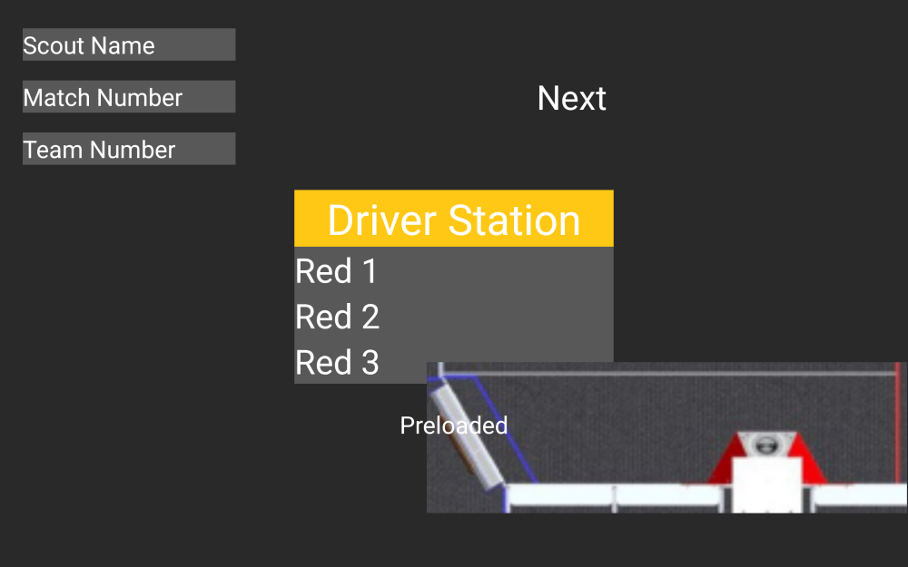
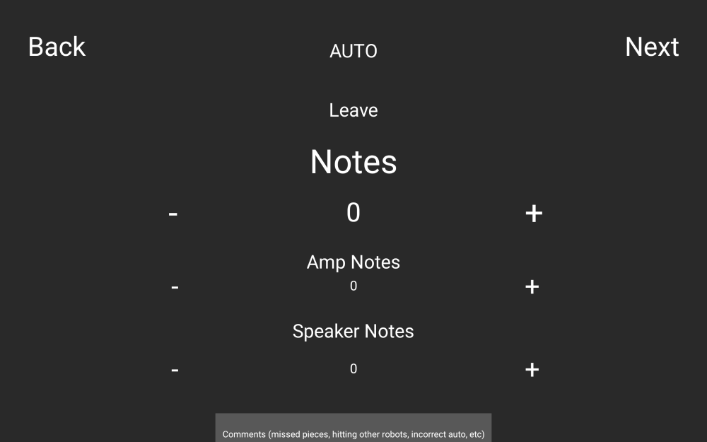
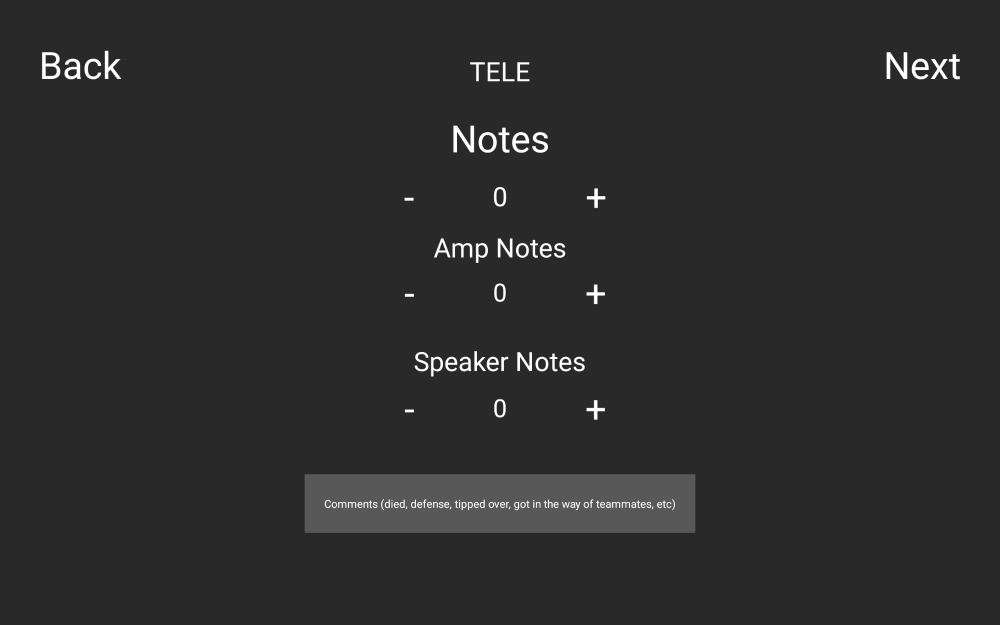
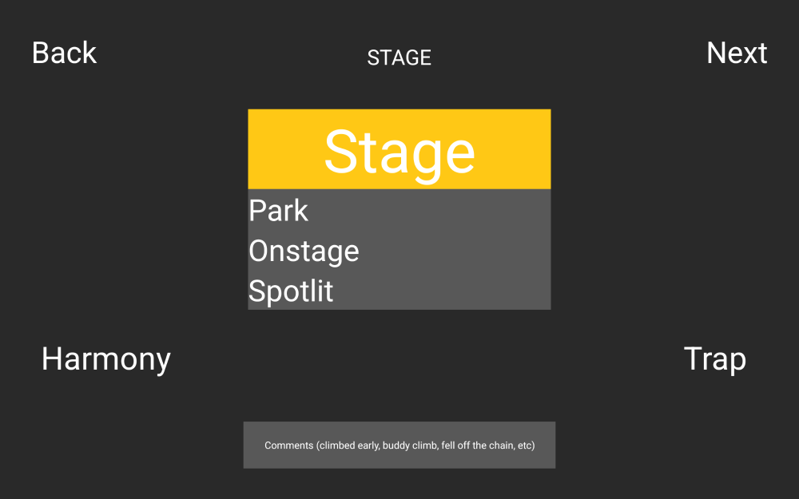
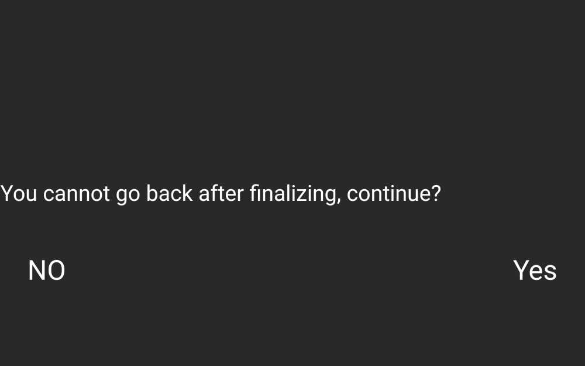
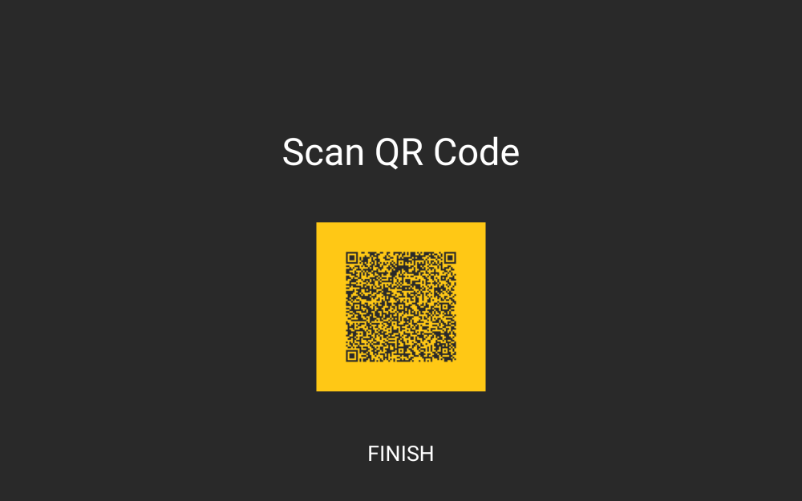
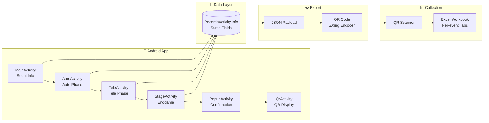

# FRC Scouting App 2024 (Crescendo)

Android match-scouting app for FRC Team 1730 (Team Driven), used during the 2024 FIRST Robotics Competition Crescendo season to collect real-time robot performance data via QR code encoding.


## Screenshots

<table>
  <tr>
    <td align="center"><br/><b>Pre-Match</b></td>
    <td align="center"><br/><b>Autonomous</b></td>
    <td align="center"><br/><b>Teleoperated</b></td>
  </tr>
  <tr>
    <td align="center"><br/><b>Endgame</b></td>
    <td align="center"><br/><b>Confirmation</b></td>
    <td align="center"><br/><b>QR Output</b></td>
  </tr>
</table>

<sub>Screenshots rendered via <a href="https://github.com/cashapp/paparazzi">Paparazzi</a> layout snapshot tests. The QR code contains sample data for team 99901.</sub>

## Features

- **Multi-phase match tracking** — Dedicated screens for Autonomous, Teleoperated, and Endgame phases
- **Game piece scoring** — Track Notes scored in Amp and Speaker during both Auto and Tele
- **Endgame tracking** — Record Stage status (Park/Onstage/Spotlit), Harmony, and Trap
- **Field position selection** — Visual field overlay for selecting robot starting position
- **Validation flow** — Confirmation screen before QR generation prevents accidental data loss
- **QR code export** — All 19 data fields encoded as JSON, displayed as scannable QR code
- **Match auto-increment** — Match number automatically increments after each submission
- **Free-text comments** — Per-phase comment fields for qualitative observations

## Usage Stats

This app collected match scouting data across **5 events**, **486 matches**, and **2,916 robot observations** during the 2024 season:

| Event | Matches | Teams | Data Points |
|-------|---------|-------|-------------|
| [Green Country Regional](https://www.thebluealliance.com/event/2024oktu) | 87 | 43 | 9,918 |
| [Heartland Regional](https://www.thebluealliance.com/event/2024ksla) | 88 | 36 | 10,032 |
| [Greater Kansas City Regional](https://www.thebluealliance.com/event/2024mokc) | 99 | 42 | 11,286 |
| [Milstein Division (Championship)](https://www.thebluealliance.com/event/2024mil) | 140 | 75 | 15,960 |
| [MO-KAN State Championship](https://www.thebluealliance.com/event/2024mksc) | 72 | 34 | 8,208 |
| **Total** | **486** | — | **55,404** |

*Formula: matches × 6 robots × 19 fields = data points*

**2024 season results supported by this scouting data:**
- 🏆 Green Country Regional winners
- 🥈 Heartland Regional finalists + Impact Award
- 🥇 Greater Kansas City Regional #1 seed
- 🥈 Milstein Division finalists
- 🏆 MO-KAN State Championship winners

See [Team 1730 on The Blue Alliance](https://www.thebluealliance.com/team/1730) for full history.

## Architecture

### Data Flow



### QR Payload Schema (19 Fields)

The app encodes all match data as a JSON object, rendered as a QR code for scanning:

```json
{
  "Name": "Scout Name",
  "Match": "1",
  "Team": "1730",
  "Preload": "1",
  "Station": "1",
  "Pos": "2",
  "Leave": "1",
  "AutoNote": "3",
  "AutoAmp": "1",
  "AutoSpeaker": "2",
  "AutoComment": "Clean auto path",
  "TeleNote": "8",
  "TeleAmp": "3",
  "TeleSpeaker": "5",
  "TeleComment": "Strong cycle time",
  "Stage": "2",
  "Harmony": "1",
  "Trap": "0",
  "StageComment": "Climbed early"
}
```

| Field | Type | Description |
|-------|------|-------------|
| `Name` | string | Scout's name |
| `Match` | string | Match number |
| `Team` | string | Robot's team number |
| `Preload` | 0/1 | Robot started with a Note preloaded |
| `Station` | 1-3 | Driver station (Red 1, 2, or 3) |
| `Pos` | 1-4 | Starting field position |
| `Leave` | 0/1 | Robot left starting zone in Auto |
| `AutoNote` | int | Total Notes picked up in Auto |
| `AutoAmp` | int | Notes scored in Amp during Auto |
| `AutoSpeaker` | int | Notes scored in Speaker during Auto |
| `AutoComment` | string | Auto phase observations |
| `TeleNote` | int | Total Notes picked up in Tele |
| `TeleAmp` | int | Notes scored in Amp during Tele |
| `TeleSpeaker` | int | Notes scored in Speaker during Tele |
| `TeleComment` | string | Tele phase observations |
| `Stage` | 0-3 | Endgame: 0=None, 1=Park, 2=Onstage, 3=Spotlit |
| `Harmony` | 0/1 | Achieved Harmony bonus |
| `Trap` | 0/1 | Scored in Trap |
| `StageComment` | string | Endgame observations |

### QR Generation

The app uses [ZXing](https://github.com/zxing/zxing) via an embedded `QRGenerator` module to encode JSON payloads:

```java
// From QrActivity.java
String json = RecordsActivity.Info.CreateJSON();
qrgEncoder = new QRGEncoder(json, null, QRGContents.Type.TEXT, 200);
bitmap = qrgEncoder.getBitmap();
```

QR codes use Team 1730's colors (yellow on dark grey) for brand consistency.

### Project Structure

```
app/
├── src/main/java/com/example/scouting_app_2024/
│   ├── MainActivity.java      # Scout info, driver station, field position
│   ├── AutoActivity.java      # Autonomous phase scoring
│   ├── TeleActivity.java      # Teleoperated phase scoring
│   ├── StageActivity.java     # Endgame (Stage, Harmony, Trap)
│   ├── PopupActivity.java     # Confirmation before finalizing
│   ├── QrActivity.java        # QR code generation and display
│   └── RecordsActivity.java   # Static data store + JSON serialization
└── src/main/res/layout/       # XML layouts for each activity
QRGenerator/                   # ZXing-based QR encoding module
```

## Build Instructions

### Prerequisites

- Java 17+ (JDK 17 or JDK 21)
- Android SDK with:
  - Platform SDK 34
  - Build Tools 34.0.0
- Gradle 8.6 (wrapper included)

### Build

```bash
# Clone the repository
git clone https://github.com/aamir-frc-scouting/frc-scouting-app-2024.git
cd frc-scouting-app-2024

# Set Android SDK path (if not set via ANDROID_HOME)
echo "sdk.dir=/path/to/android/sdk" > local.properties

# Build debug APK
./gradlew assembleDebug

# Output: app/build/outputs/apk/debug/app-debug.apk
```

### Install on Device

```bash
# Connect Android device with USB debugging enabled
adb install -r app/build/outputs/apk/debug/app-debug.apk
```

## What I'd Change / What Came Next

This Java/Android + QR-to-Excel pipeline worked reliably for the 2024 season, but had limitations:

**Pain points identified:**
- Manual QR scanning into Excel was time-consuming between matches
- No real-time data aggregation or analysis
- Platform-specific (Android only)
- No offline data persistence on device

**2025 Rewrite (Flutter + SQL):**

In 2025, I rebuilt the scouting apps in **Dart/Flutter** with **SQLite** for data storage:
- Cross-platform Flutter apps (one codebase for Android + iOS)
- Same QR transfer workflow, but scanned into a Python/customtkinter desktop intake app that validates each record
- SQLite instead of Excel tabs, so strategy questions become SQL queries
- Offline-first architecture with persistent storage on device

See the [FRC Scouting Organization](https://github.com/aamir-frc-scouting) for the 2025 apps and other scouting tools.

## License

*No license has been added yet. Consider adding MIT, Apache 2.0, or another open source license to clarify usage permissions.*

## Author

**Aamir Abatiyow** — FRC Team 1730 (Team Driven), 2023–2025

- Organization: [github.com/aamir-frc-scouting](https://github.com/aamir-frc-scouting)
